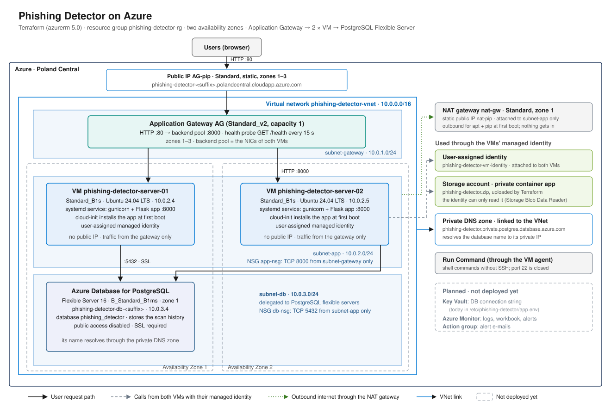

# Phishing Detector on Azure

Terraform that deploys a Flask phishing-detection web app on Azure: an Application Gateway in front of two Ubuntu VMs in separate availability zones, backed by a private PostgreSQL database.



## What it deploys

- **Network:** one VNet (`10.0.0.0/16`) with gateway, app and database subnets. NSGs let the app subnet accept only port 8000 from the gateway, and the database subnet only port 5432 from the app subnet.
- **Application Gateway** (Standard_v2): the only public entry point. HTTP on port 80, health probe on `/health`.
- **2 VMs** (Standard_B1s, Ubuntu 24.04) in zones 1 and 2, with no public IP and SSH closed. On first boot, each one downloads the app from a private storage account using a managed identity and runs it with gunicorn on port 8000.
- **PostgreSQL Flexible Server 16:** private access only, resolved through a private DNS zone. Stores the scan history.
- **NAT gateway:** outbound-only internet, so the VMs can install packages.

Shown in the diagram but not implemented yet: Key Vault for the database connection string, and Azure Monitor with alerts.

## Prerequisites

- [Terraform](https://developer.hashicorp.com/terraform/install) (tested with 1.17)
- [Azure CLI](https://learn.microsoft.com/cli/azure/install-azure-cli), logged in with `az login`. Terraform uses your current `az account` subscription.
- Owner rights on that subscription, because the VMs' identity gets a role assignment.

## Deploy

```sh
terraform init
terraform apply
terraform output app_url
```

`apply` takes about 15 minutes. Give the VMs another 5 minutes to install the app, then open `app_url`. The page footer shows which VM served the request.

Run `terraform destroy` when you're done: the gateway, NAT gateway and database are billed by the hour.

## Configuration

All variables have defaults. The main ones:

| Variable | Default | Description |
|---|---|---|
| `location` | `Poland Central` | Azure region. Some subscriptions, such as Azure for Students, only allow certain regions. |
| `prefix` | `phishing-detector` | Prefix for resource names |
| `vm_size` | `Standard_B1s` | Size of the app VMs |
| `db_name` | `phishing_detector` | Database the app uses |
| `app_zip` | `Phishing_detector_VM_files-main.zip` | App package uploaded for the VMs |

Override them with `-var name=value` or in a `terraform.tfvars` file.

## Updating the app

Replace the zip and run `terraform apply` to upload it. VMs that are already running keep their version until you redeploy them; do one at a time to avoid downtime:

```sh
az vm run-command invoke -g phishing-detector-rg -n phishing-detector-server-01 --command-id RunShellScript --scripts /usr/local/bin/deploy-phishing-detector
```

## Files

| File | Contents |
|---|---|
| `main.tf` | Providers, resource group, network, Application Gateway, VMs |
| `network-security.tf` | NSGs for the app and database subnets |
| `nat-gateway.tf` | Outbound internet for the VMs |
| `database.tf` | PostgreSQL server, database and private DNS zone |
| `storage.tf` | Storage account for the app package, and the VMs' read access to it |
| `cloud-init.yaml.tftpl` | First-boot setup: download, install and run the app |
| `variables.tf`, `outputs.tf` | Inputs and outputs |
| `app/` | Source code of the Flask phishing-detector app (readable copy) |
| `Phishing_detector_VM_files-main.zip` | The same app, zipped. This is what Terraform uploads to the VMs, so re-zip `app/` after changing it. |

## Security note

The Terraform state contains the database password and the VMs' SSH private key. Keep it private: `.gitignore` excludes it from the repository.

## License

[MIT](LICENSE)
